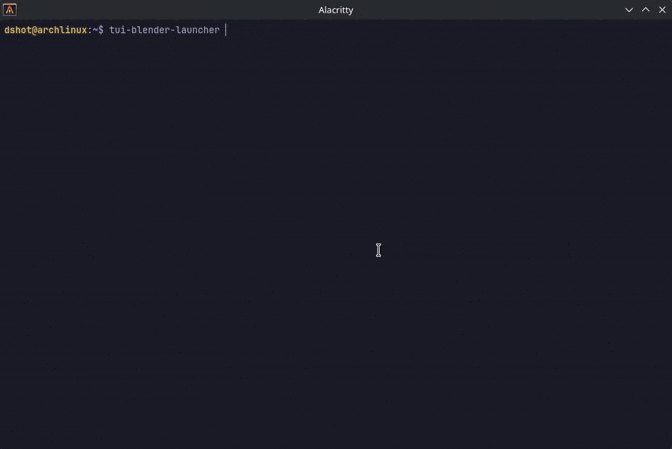

# TUI Blender Launcher

A terminal user interface (TUI) for finding, downloading, managing, and launching Blender builds. It uses the official Blender BuildBot API and keeps installed builds organized on disk.



## Features

- Browse daily, patch, and experimental Blender builds
- Filter builds by version number, including wildcards such as `4.x` or `5.x`
- Filter by release type: alpha, beta, candidate, and stable
- Sort by version, status, branch, type, hash, size, and build date
- Download builds with real-time progress and cancellation
- Verify downloaded archives against API checksums
- Manage locally installed Blender builds and launch them directly
- Move superseded builds to `.oldbuilds` and clean them up
- Configure the download directory with shell-style tab completion
- Inspect the selected build in an adaptive information panel
- Open a build's download URL in your browser
- Themeable UI with dracula, catppuccin, nord, gruvbox, and tokyonight
- Cross-platform support for Linux, macOS, and Windows

## Requirements

Runtime requirements:

- A terminal emulator
- On Linux, launching Blender opens it in a terminal emulator (`x-terminal-emulator`, `gnome-terminal`, `alacritty`, `xterm`, or `konsole`)

Build from source requirements:

- Go 1.23 or newer
- Git

## Installation

### 1. Prebuilt binaries (recommended)

Download the archive for your operating system and architecture from the [latest GitHub Release](https://github.com/dshot92/TUI-Blender-Launcher/releases/latest), then extract and place `tui-blender-launcher` on your `PATH`.

Linux / macOS:

```bash
tar -xzf tui-blender-launcher_*_linux_amd64.tar.gz
chmod +x tui-blender-launcher
mv tui-blender-launcher ~/.local/bin/
tui-blender-launcher --version
```

macOS Apple Silicon uses `_darwin_arm64`, and Windows users can extract the `.zip` and run `tui-blender-launcher.exe`.

Optional integrity check:

```bash
sha256sum -c checksums.txt
```

### 2. Go install

```bash
go install github.com/dshot92/TUI-Blender-Launcher@latest
tui-blender-launcher --version
```

Ensure your Go bin directory is on `PATH` (usually `$(go env GOPATH)/bin`).

### 3. Build from source

```bash
git clone https://github.com/dshot92/TUI-Blender-Launcher.git
cd TUI-Blender-Launcher
go mod tidy
go build -o tui-blender-launcher .
./tui-blender-launcher
```

### 4. Makefile install

```bash
git clone https://github.com/dshot92/TUI-Blender-Launcher.git
cd TUI-Blender-Launcher
make install
tui-blender-launcher
```

`make install` builds the binary and creates a symlink at `~/.local/bin/tui-blender-launcher`.

Uninstall later with:

```bash
make uninstall
```

## First run

On first launch, the application asks for the initial configuration and creates the config file automatically. You can change these values later in the settings view.

Default configuration:

```toml
download_dir = "~/blender/blender-builds"
version_filter = "4.x"
build_type = "daily"
release_types = ["alpha", "beta", "candidate", "stable"]
theme = "dracula"
uuid = "randomly-generated"
```

The initial setup may use a fully expanded download path.

## Configuration

Settings are stored in your OS user configuration directory:

- **Linux**: `~/.config/tui-blender-launcher/config.toml`
- **macOS**: `~/Library/Application Support/tui-blender-launcher/config.toml`
- **Windows**: `%AppData%\tui-blender-launcher\config.toml`

Available settings:

- `download_dir`: where Blender builds are downloaded and installed
- `version_filter`: minimum version filter, for example `4.0`, `3.6`, `4.x`, or empty for no filter
- `build_type`: one of `daily`, `patch`, or `experimental`
- `release_types`: release cycles to display; empty means all
- `theme`: UI palette
- `uuid`: generated automatically

Themes:

| Name | Description |
| --- | --- |
| `dracula` | Dracula palette (default) |
| `catppuccin` | Catppuccin Mocha |
| `nord` | Nord |
| `gruvbox` | Gruvbox Dark |
| `tokyonight` | Tokyo Night |

An unknown or empty theme falls back to `dracula`.

File layout:

- Downloads in progress are stored in `[download_dir]/.downloading`
- Superseded builds are moved to `[download_dir]/.oldbuilds`

## Usage

### Navigation

- `Up` / `k`: move cursor up
- `Down` / `j`: move cursor down
- `Left` / `h`: previous sort column
- `Right` / `l`: next sort column
- `Page Up` / `Page Down`: move by page
- `Home` / `End`: first or last item

### Builds view

- `f`: fetch online builds
- `Enter`: launch selected build
- `o`: open build directory
- `u`: open selected build's download URL
- `x`: delete a local build, or cancel an in-progress download
- `d`: download selected build
- `r`: reverse sort order
- `Tab`: show or hide the build information panel
- `s`: open settings
- `q` / `Ctrl+C`: quit

When the terminal is wide enough, the information panel docks beside the list. On narrower terminals it docks below the list.

### Settings view

- `Up` / `Down` or `k` / `j`: select a setting
- `Left` / `Right` or `h` / `l`: change the selected option
- `Enter`: edit the selected text setting or toggle release types
- `Space`: toggle a release type while editing release types
- `s`: save and return to builds
- `Esc`: cancel the current edit
- `q`: quit

The download directory editor supports path tab completion.

## Blender BuildBot API

This application uses the official Blender BuildBot API:

```
https://builder.blender.org/download/<category>/?format=json&v=1
```

Where `<category>` can be:

- `daily`: latest development builds from the master branch
- `patch`: patch builds from pull requests
- `experimental`: experimental builds from specific branches

For more details, see the [Blender BuildBot documentation](https://developer.blender.org/docs/handbook/tooling/buildbot/#builds-listing-api).

## Development

Run the common checks:

```bash
make fmt
make vet
make test
```

Additional targets:

```bash
make lint          # fmt + vet + tests
make release-check # validate GoReleaser config
```

Build a release-style binary locally:

```bash
make build   # injects a git-derived version (e.g. v1.0.0-5-gabc1234)
```

Pushing a version tag creates a GitHub release and uploads all binaries:

```bash
git tag v1.0.0
git push origin v1.0.0
```

## License

This project is licensed under the GNU General Public License v3.0. See `LICENSE`.

## Acknowledgements

- [Charm](https://charm.sh/) for Bubble Tea, Bubbles, and Lip Gloss
- The Blender Foundation and BuildBot for public build artifacts